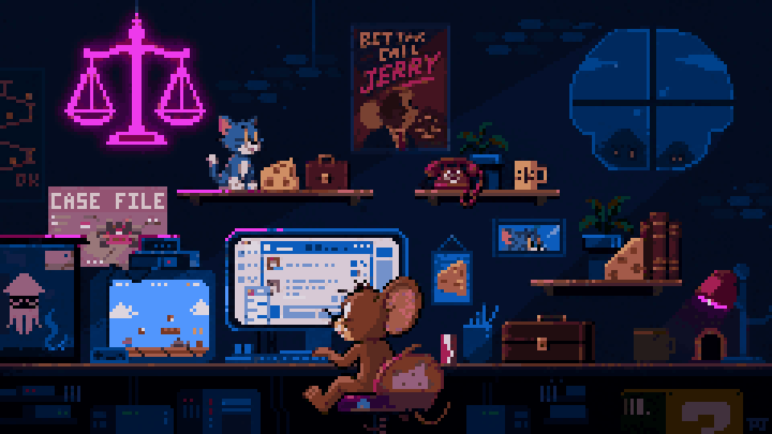
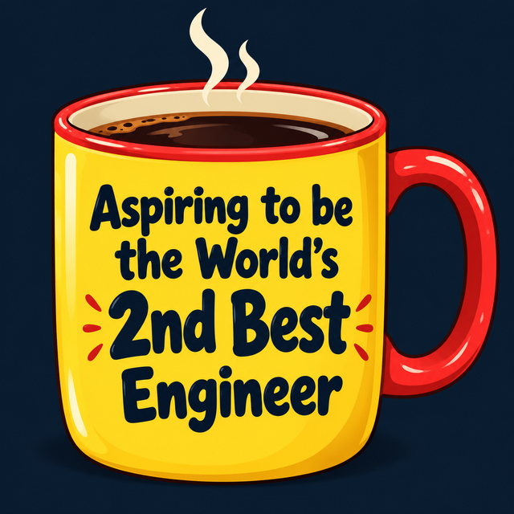

### Hi, I'm Jerry_codemen 👋

**A passionate AI algorithm engineer from Shenzhen, China.**

I work on **embodied AI at Standard Robots**, with a focus on **humanoid robots**. I'm developing in-house models for **whole-body control** and **long-horizon tasks in industrial settings**.

My core experience is in **reinforcement learning for dexterous hands**. Today, I'm exploring how **LLMs, VLAs, reinforcement learning, and world models** can work together to build useful industrial robots.

**What I build for:** practical deployment, measurable **ROI**, **reliability**, and **safety**.

  

<em>Learning by building. Sharing along the way.</em>

  

  <strong>Embodied AI · Humanoid Robotics · Standard Robots</strong>

  
  
  
  

 

  

### On my workbench 🧪

I'm working on **hierarchical architectures** and **VLA policies (including π0.5)**, with ongoing explorations in **TTT** and **HIL-SERL / RLT**.

- 🦾 **Flow Reversal Steering & RTC Steering** — Reproducing FRS and integrating human guidance with asynchronous robot execution, keeping corrected actions and model continuations aligned.
- 🎯 **RECAP / PiStar** — Building a RECAP-style post-training pipeline from real-robot rollouts and human interventions to value learning and advantage-conditioned policies, with initial real-robot trials.
- 🌍 **Cosmos** — Experimenting with action-conditioned world-model data synthesis, focusing on multi-view consistency and temporal memory through occlusions.

*These projects are in progress, with evaluation and iteration ongoing. I'm organizing write-ups and demos, and plan to share selected code as it becomes ready.*

  

