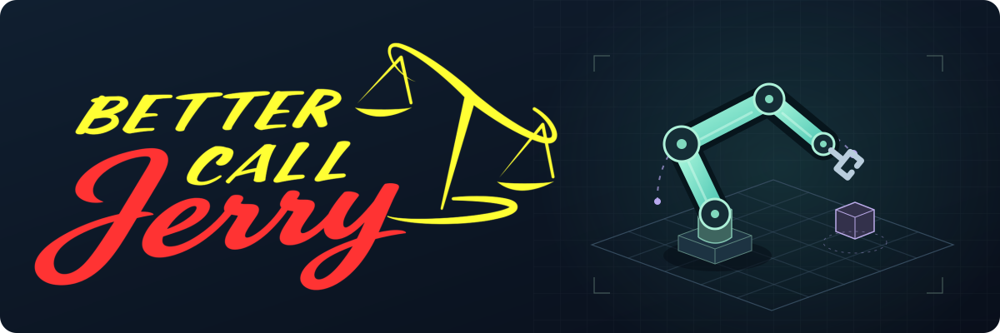

  

  <strong>Embodied AI · Robotics Algorithms · Standard Robotics</strong> 
  Connecting language, learning, and action.

---

### Hi, I'm Jerry_codemen 👋

I'm an developer working on **embodied AI and robotics algorithms** at **Standard Robots**.

I'm interested in how language, learning, and world models can help robots understand and act in the physical world.

### Interests

| Area | Interest |
| :--- | :--- |
| **LLM** | Large Language Models |
| **VLA** | Vision-Language-Action Models |
| **RL** | Reinforcement Learning |
| **WM** | World Models |

### Projects & experiments

I'm organizing my projects and code for sharing here. Project write-ups and demos will be added as they become ready, with selected code considered for open-source release.

---

<em>Learning by building. Sharing along the way.</em>

