<h1 align="center">Jerry_codemen</h1>

  <strong>Embodied AI Algorithm Engineer</strong> 
  Standard Robots · Shenzhen, China

I build models for **humanoid whole-body control** and **long-horizon industrial tasks**, with a background in **reinforcement learning for dexterous hands**. My focus: practical deployment, **ROI, reliability and safety**.

  
  
  
  

  

### Selected work

Ongoing experiments in industrial embodied AI. Source code is currently private.

  

- **RTC Steering** — Prototyping human-guided action corrections that stay aligned with asynchronous robot execution and subsequent policy predictions.
- **VLA distillation** — Comparing π0.5 compression recipes through matched-budget offline evaluations and teacher-consistency checks.
- **Temporal memory / TTT** — Stabilizing fast-weight updates and testing whether remembered observations influence action decisions.
- **Experience learning** — Adapting RECAP, HIL-SERL and RLT pipelines, with early robot experiments and control/data-interface diagnostics.
- **Robot world models** — Exploring Cosmos-based action-conditioned video generation, multi-view consistency and long-sequence drift.

  

  

  
A tiny robot break

  

    
  

